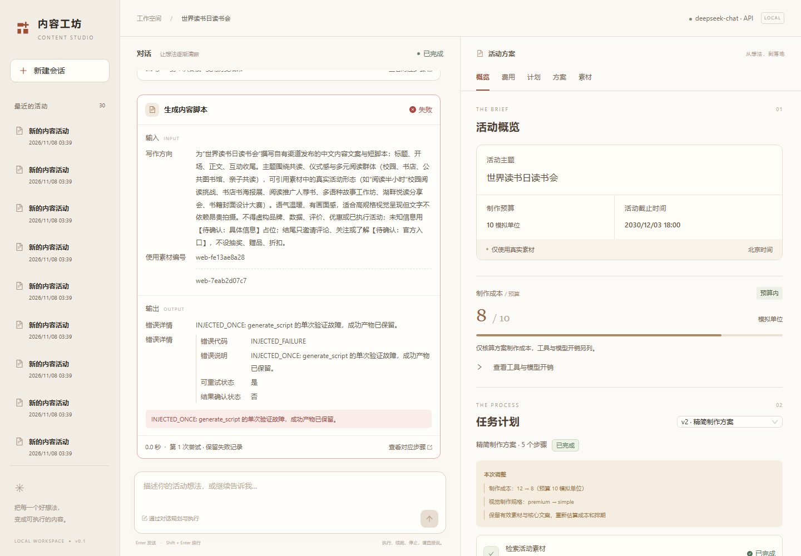

# 内容工坊

一个通过聊天生成内容活动方案的 Agent。输入主题、制作预算和截止时间，它会先给出计划；回复“开始”后，才检索素材、生成脚本、估算成本并保存方案。

预算不够时会重新选方案；工具失败时保留已完成的结果，可以重试或从失败处继续。聊天中能看到工具的输入、输出和耗时，右侧显示计划、费用、素材来源和完整方案。支持 Markdown、JSON 导出。

项目定位、系统架构与设计思路见[项目总览](docs/00-overview.md)。



## 本地运行

需要 Python 3.12、Node.js 24、Docker。使用本地模型时还需要 Ollama。实际测试环境是 Windows，下面使用 PowerShell。

### 安装

在项目根目录执行：

```powershell
python -m venv .venv
.venv\Scripts\python.exe -m pip install -r requirements.lock.txt
npm ci

Copy-Item .env.example .env
Copy-Item config/app.example.yaml config/app.yaml
docker compose up -d postgres

$env:PYTHONPATH='src/backend'
$env:PYTHONUTF8='1'
.venv\Scripts\python.exe -m app.cli initdb
```

已有配置时不要覆盖自己的文件。PostgreSQL 绑定本机5433端口，数据保存在 Docker 卷中。`initdb` 会执行 Alembic 迁移并初始化 LangGraph 检查点。旧数据库需要补录费用账本时，再执行 `python -m app.cli backfill-ledger`。

默认使用 Ollama：

```powershell
ollama pull qwen3:latest
```

保持 Ollama 服务运行。使用 DeepSeek 可以跳过模型下载，按下面的配置说明切换。

### 启动

```powershell
powershell -ExecutionPolicy Bypass -File scripts/start.ps1
```

脚本启动前端、API、MCP Server 和两个 worker，日志写入 `.runtime/`。打开 <http://127.0.0.1:5173/>。

也可以分别开终端运行，方便调试。每个 Python 终端都需要设置 `PYTHONPATH=src/backend` 和 `PYTHONUTF8=1`。

```powershell
.venv\Scripts\python.exe -m app.cli mcp
.venv\Scripts\python.exe -m app.cli api
.venv\Scripts\python.exe -m app.cli worker message
.venv\Scripts\python.exe -m app.cli worker run
npm run dev
```

API 文档在 <http://127.0.0.1:8000/docs>，健康检查在 <http://127.0.0.1:8000/api/health>。MCP 地址为 `http://127.0.0.1:8001/mcp`，浏览器只访问 API。

### 模型和搜索

在 `config/app.yaml` 中选择 `active_model: local_qwen3` 或 `deepseek`。模型地址、名称、超时和生成参数也在这个文件中。DeepSeek 的模型名称按账户实际可用的 ID 填写；已保存的测试使用 `deepseek-chat`。

在 `.env` 填写：

```dotenv
DEEPSEEK_API_KEY=
TAVILY_API_KEY=
```

Tavily 用于联网检索。不填搜索密钥也可以使用合成素材；要求必须真实来源的任务会报告资料不足。需要代理时，在 YAML 的 `mcp` 下设置 `proxy_url`，例如 `http://127.0.0.1:7890`。只在对应代理可用时配置，TLS 证书校验保持开启。

新运行读取新配置，已有运行及续跑保留原快照。模型失败不会自动换到另一家服务。

## 使用

把活动主题、预算和明确的截止时间发给 Agent。缺少信息时，它会在聊天中追问。看过计划后发送“按这个计划开始执行”。

执行中可以说“停止当前任务”或提出修改。当前工具结束后会保留结果、停止旧计划，修改后的计划需要重新确认。失败时可以说“从失败处继续”。导出入口位于方案阅读区。

预算使用模拟单位，只限制方案制作成本。工具模拟费、模型 token 和供应商费用单独显示。未配置单价的费用显示未知，不计为0。排期按自然小时、北京时间、单团队串行计算。

## 测试

```powershell
$env:PYTHONPATH='src/backend'
$env:CONTENT_STUDIO_DB_TESTS='1'
.venv\Scripts\python.exe -m pytest tests/backend -q

npm run typecheck
npm run build
npx playwright install chromium
npm run test:e2e
```

数据库测试需要 PostgreSQL；不设置 `CONTENT_STUDIO_DB_TESTS` 会跳过这部分。默认浏览器用例中的 `/demo` 是界面演示，不能用来证明模型决策。

后端回归已有170项通过记录。真实外部测试保存了8组场景和27项预算、依赖、失败与重规划审计。查看[测试报告](docs/03-evaluation.md)或[案例](examples/README.md)。真实模型测试的命令也放在对应报告中，会使用模型或搜索额度。

只检查已有交付材料，不需要启动服务：

```powershell
python scripts/check_delivery.py
python scripts/audit_external_review.py
```

第一条需要 Git，用临时仓库检查忽略规则。两条命令都不调用模型或数据库。

## 目录

```text
src/frontend/       React 工作台
src/backend/app/    API、Agent、MCP、worker 和业务规则
src/backend/migrations/
skills/            产品内 Agent 使用的 Skill
data/              合成素材和成本、工期规则
tests/             后端及浏览器测试
examples/          实际输入、输出、Trace 和测试报告
docs/              需求、设计和验证说明
```

项目说明：[总览](docs/00-overview.md) · [需求](docs/01-requirements.md) · [设计](docs/02-solution.md) · [实施思路](docs/13-development-approach.md) · [测试](docs/03-evaluation.md) · [AI使用](docs/04-ai-usage.md) · [复盘](docs/05-retrospective.md) · [执行计划](execution-plan.md) · [交付清单](docs/12-delivery-check.md)。

## GitHub交付

题目：内容任务规划 Agent。公开仓库为 [Askar27531/content-task-agent](https://github.com/Askar27531/content-task-agent)，默认分支为 `main`。最终提交SHA可通过 `git rev-parse HEAD` 或[提交列表](https://github.com/Askar27531/content-task-agent/commits/main)核对。

自动检查见 [GitHub Actions](https://github.com/Askar27531/content-task-agent/actions/workflows/check.yml)。上传前的[170项后端回归](examples/submission/backend.xml)、[4项页面回归](examples/submission/playwright.json)及[交付检查](examples/submission/delivery-audit.json)保存在仓库中；真实模型和外部搜索材料见上述案例入口。

## 限制和排错

目前是本地单用户应用，没有登录；制作规则只有 premium/simple 两种套餐，不生成图片、视频，也不代发布或付款。生成的文案需要运营核对产品事实。Linux完整模型场景仍待验证，CI状态见仓库Actions，前端主包仍需拆分。

Docker Hub 拉取失败时，可以尝试同一官方镜像的公开 ECR 源：

```powershell
docker pull public.ecr.aws/docker/library/postgres:17-alpine
docker tag public.ecr.aws/docker/library/postgres:17-alpine postgres:17-alpine
docker compose up -d --pull never postgres
```

仍无法下载时，`scripts/fetch_postgres_image.py` 可从该源下载并校验镜像，输出 `.runtime/postgres-17-alpine.tar`，再通过 `docker load --input` 导入。已有数据库升级只运行迁移，不要删除数据卷。
